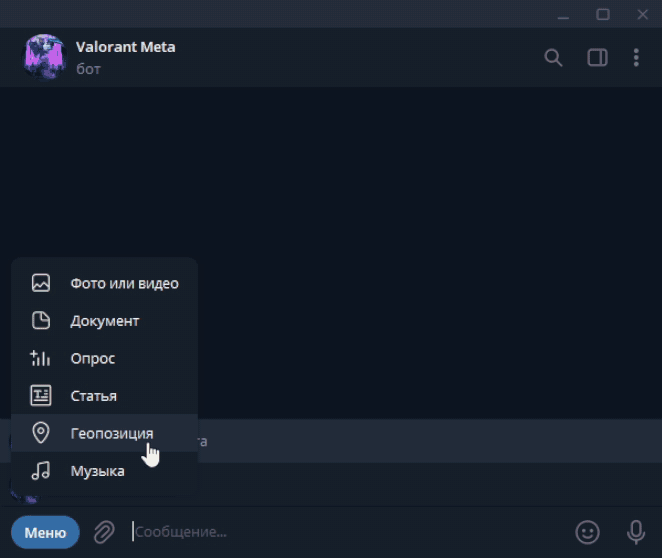
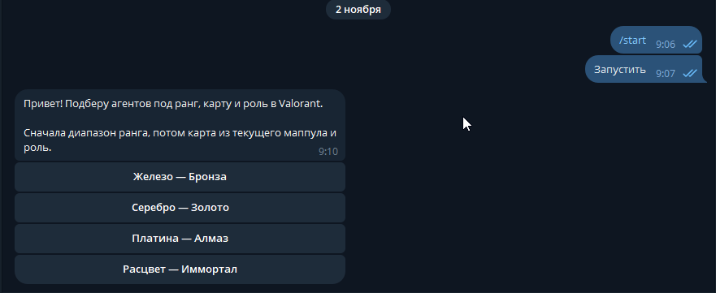
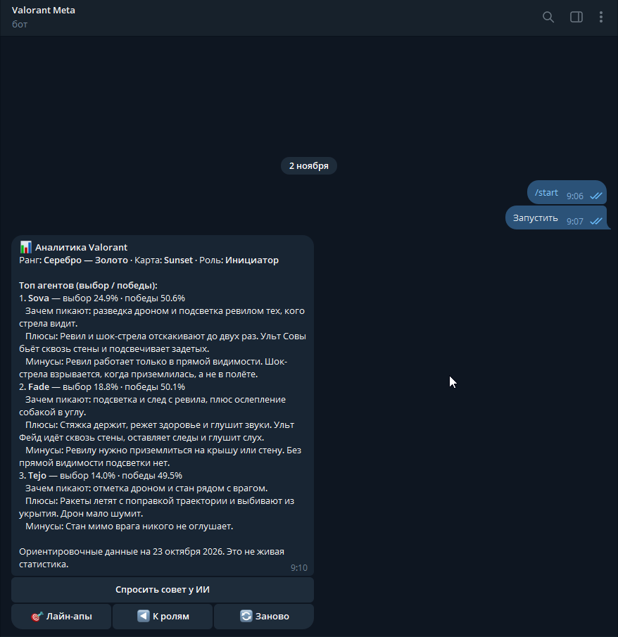
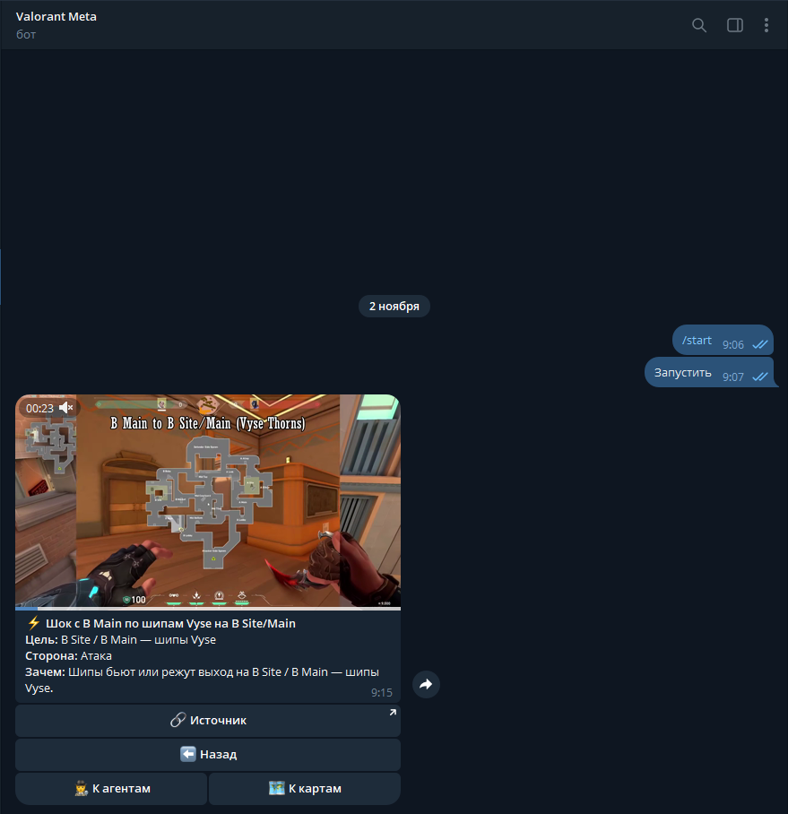

# Valorant Meta Bot

Telegram-бот для игроков Valorant: подбирает агентов под ранг, карту и роль, даёт совет от GigaChat и показывает раскидки (лайн-апы) короткими видео прямо в чате.



## Что умеет

- **Подбор агентов.** Пользователь выбирает ранг (4 группы: Железо–Бронза, Серебро–Золото, Платина–Алмаз, Расцвет–Иммортал), карту и роль: дуэлянт, инициатор, смокер или сентинел. Бот показывает топ-3 агента для этой карты и роли.
- **Карточка агента.** В карточке есть ориентиры по пикрейту и винрейту с поправкой на ранг. Там же профиль агента из `agents.json`: зачем его берут, плюсы и минусы, отдельно для каждой группы рангов. Профили есть у 27 агентов.
- **Совет от ИИ.** По кнопке «Спросить совет у ИИ» GigaChat отвечает тремя пунктами: кого взять, как играть роль на карте и какую ошибку типично делают на этом ранге. Совет приходит отдельным сообщением, повторный запрос редактирует то же сообщение.
- **Каталог раскидок.** Путь по меню: карта → роль → агент → сторона (атака или защита) → сайт (A/B, на Haven ещё C и Mid, на Bind Mid) → список → видео. В каталоге **964 раскидки** на 13 агентов:

  | Карта | Раскидок |
  |---|---|
  | Bind | 261 |
  | Haven | 259 |
  | Summit | 164 |
  | Sunset | 161 |
  | Corrode | 69 |
  | Ascent* | 50 |

  \* Ascent есть в данных, но в меню карт пока не выведен.

- **Подпись к раскидке:** тип, цель, сторона, зачем она нужна и источник. Под видео есть кнопка «Источник» со ссылкой на оригинал. На кнопках списка стоят эмодзи по типу раскидки: 🧩 сетап, 🌀 телепорт, 📷 камера, 🧵 растяжка и т. д.
- **Быстрая отправка видео.** 694 ролика уже залиты в Telegram и отправляются по `file_id`, мгновенно и без лимитов на размер. Для остальных бот пробует по очереди: кэш `file_ids.json`, локальный mp4, ссылку и скачивание со сжатием через ffmpeg.
- **Один экран в чате.** Бот редактирует одно сообщение-меню и удаляет старые сообщения перед показом видео, так что переписка не засоряется. Под «Назад» есть быстрые переходы «К агентам» и «К картам».
- Агент показывается в списке только на тех картах, где у него есть раскидки. Каталог кэшируется и перечитывается, только когда меняется `lineups.json`.
- Команда `/id` возвращает Telegram user id отправителя.

## Скриншоты

| Выбор карты и роли | Карточка + совет ИИ | Раскидка |
|---|---|---|
|  |  |  |

## Стек

- **Python 3.13** (aiogram пока не ставится на 3.15, работает на 3.11–3.13)
- **aiogram 3**: Router, CallbackData-фабрики, FSM (`MemoryStorage`), HTML-разметка
- **GigaChat** (`gigachat` SDK, модель по умолчанию `GigaChat-2`). Синхронный клиент вызывается через `asyncio.to_thread`, чтобы не блокировать event loop
- **aiohttp**: скачивание видео и проверка размера по `Content-Length`
- **yt-dlp** + **curl_cffi**: загрузка роликов с YouTube и TikTok
- **ffmpeg / ffprobe**: обрезка, перекодирование в H.264 720p и `+faststart`
- **python-dotenv**: конфигурация через `.env`

## Архитектура

```
main.py               точка входа: проверка .env, Dispatcher, polling
handlers.py           сценарий диалога (роутер, все шаги меню, показ видео, совет ИИ)
keyboards.py          инлайн-клавиатуры
callbacks.py          CallbackData-фабрики
states.py             FSM-состояния
constants.py          ранги, карты, роли, сайты, эмодзи для кнопок раскидок
analytics.py          META-ориентиры (пик/вин), поправка на ранг, сборка карточки
agents.json           профили агентов по 4 группам рангов
GLOSSARY.md           единый словарь названий способностей для текстов
gigachat_client.py    один клиент GigaChat на процесс, генерация совета
lineups.py            загрузка и кэш каталога раскидок
lineups.json          каталог: карта → агент → раскидки
lineups_view.py       отправка видео: file_id → локальный mp4 → URL → скачивание + ffmpeg
scripts/warm_cache.py добор file_id для старых записей (продолжает с места остановки)
tools/                пайплайн контента: download / upload / merge / normalize
incoming/             пакеты новых раскидок по картам и ролям до слияния
```

Подробнее для разработки: [`PROJECT.md`](PROJECT.md).

## Пайплайн контента

Новые раскидки собираются пакетами (`incoming/lineups_<карта>_<сайт>_<роль>.json`) и проходят четыре шага:

1. **Скачать** (`tools/download_lineups.py`). yt-dlp качает ролик ≤720p, ffmpeg вырезает фрагмент `clip_start`–`clip_end` и перекодирует его в H.264 yuv420p, ≤720p, ≤30 fps, с `+faststart`. Если файл больше 20 МБ, скрипт пережимает его по целевому битрейту. Путь к файлу записывается в `local_file`.
2. **Залить** (`tools/upload_videos.py`). Ролик отправляется в служебный чат тем же ботом, бот получает `file_id`, и служебное сообщение сразу удаляется. Перед заливкой ролик ужимается под лимит 50 МБ. Есть `--dry-run` (только сжать и показать размеры), `--strip-audio`, `--remux-ok` и поддержка self-hosted Bot API (до 2000 МБ).
3. **Слить** (`tools/merge_*.py`). Пакет дописывается в `lineups.json` без дублей по `id` и `source`.
4. **Нормализовать** (`tools/normalize_lineup_descriptions.py`). Подписи приводятся к единому формату: цель, сторона, зачем.

`file_id` привязан к токену, поэтому заливать нужно тем же ботом, который потом отправляет ролики. Поля `source` и `video_src` сохраняются, по ним ролик можно перезалить.

Полный список команд по каждой карте: [`CONTENT_PIPELINE.md`](CONTENT_PIPELINE.md).

## Запуск

1. Установите Python 3.13 и ffmpeg (нужен для сжатия роликов больше 50 МБ и для пайплайна):

   ```bash
   winget install Gyan.FFmpeg
   ```

   После установки откройте новый терминал.

2. Установите зависимости:

   ```bash
   py -3.13 -m pip install -r requirements.txt
   ```

3. Создайте `.env` в корне (в git не попадает):

   ```env
   BOT_TOKEN=токен_от_BotFather
   GIGACHAT_CREDENTIALS=ключ_авторизации_GigaChat
   ADMIN_CHAT_ID=ваш_telegram_id   # для прогрева кэша и заливки роликов
   # GIGACHAT_MODEL=GigaChat-2     # необязательно
   ```

4. Запустите бота:

   ```bash
   py -3.13 main.py
   ```

> На Windows команда `python` может открывать заглушку Microsoft Store, поэтому используйте `py -3.13`.

## Источники раскидок

Видео раскидок взяты из открытых источников: YouTube, TikTok, blitz.gg и tricks.gg. Все права на них принадлежат авторам. У каждой раскидки в `lineups.json` сохранена ссылка на оригинал (`source` / `video_src`), источник указан в подписи, а под видео есть кнопка «Источник». Если вы автор и хотите убрать свой ролик, напишите мне, я удалю его.

## Ограничения и планы

- Цифры в карточке — округлённые ориентиры на 23 октября 2026, а не live-статистика Tracker.gg / VLR / OP.GG.
- FSM хранится в памяти, поэтому после перезапуска бота диалог сбрасывается.
- В планах: раскидки для Abyss и Lotus, смокеры с ван-веями для Sunset и Bind, больше дуэлянтов и сентинелов на Corrode.
